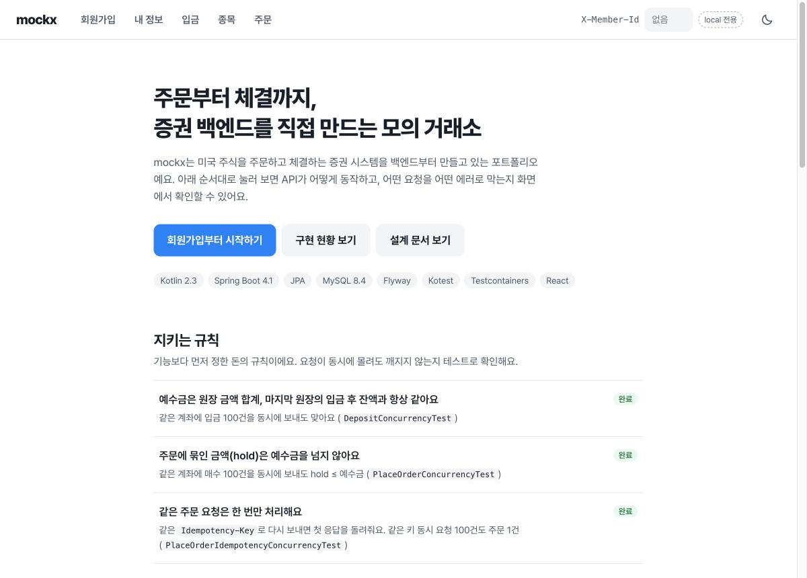

# mockx

모의 증권 주문·체결 시스템(Mock Exchange). 계좌·예수금·원장부터 지정가 주문, 동시성 제어, 매칭 엔진까지 증권 백엔드의 핵심 흐름을 직접 구현하는 프로젝트입니다. 기능 개수보다 **요청이 동시에 몰려도 돈이 틀리지 않는다**는 규칙을 테스트로 증명하는 데 집중합니다.

- 기간: 2026-10-08 ~ 진행 중 (마지막 갱신 2026-11-20)
- 백엔드: Kotlin 2.3, Spring Boot 4.1, JPA, MySQL 8.4, Flyway, Kotest, Testcontainers
- 시연용 프론트: React, Vite, TypeScript, Vitest
- 시세 수집 워커(예정): TypeScript, NestJS, Redis, ELK



## 지키는 규칙

| 규칙 | 상태 | 검증 |
|---|---|---|
| 예수금 = 원장 금액 합계 = 마지막 원장의 입금 후 잔액(`balance_after`) | 완료 | 같은 계좌 동시 입금 100건(`DepositConcurrencyTest`), 연속 입금(`DepositE2ETest`) |
| 회원 저장·계좌번호 발급·계좌 저장은 함께 성공하거나 함께 롤백 | 완료 | 계좌 개설을 일부러 실패시켜 회원도 남지 않는지 확인(`SignupE2ETest`) |
| 남의 계좌는 없는 계좌와 같은 404로 응답하고 아무것도 바꾸지 않음 | 완료 | `DepositE2ETest` |
| 주문에 묶인 금액(hold) ≤ 예수금 | 완료 | 예수금 $100 계좌에 $3 매수 100건을 동시에 보내면 33건만 접수되고 67건은 422, hold = 접수 주문 합계(`PlaceOrderConcurrencyTest`) |
| 같은 주문을 동시에 여러 번 취소해도 hold는 한 번만 풀림 | 완료 | 같은 주문에 취소 10건을 동시에 보내면 1건만 성공하고 9건은 409, hold = 남은 접수 주문 합계(`CancelOrderConcurrencyTest`) |
| 같은 주문 요청은 한 번만 처리 | 완료 | 같은 `Idempotency-Key`로 다시 보내면 첫 응답을 재사용하고 주문·hold는 한 번만 생김(`PlaceOrderIdempotencyE2ETest`), 같은 키 동시 요청 100건도 주문 1건(`PlaceOrderIdempotencyConcurrencyTest`) |

## 화면으로 보기

시연용 프론트의 첫 화면(`/`)에 시연 순서를 적어 두었습니다. 단계마다 일부러 내 볼 만한 에러(대소문자만 다른 중복 가입 409, 남의 계좌 404, 허용되지 않은 정렬 400 등)도 함께 적었습니다. 실행 방법은 [실행](#실행)을 참고하세요.

## 설계 문서

구현과 테스트 기대값은 `docs/`의 설계 문서를 기준으로 합니다. 문서마다 선택지와 고른 이유, 포기한 것을 적었습니다.

| 문서 | 내용 |
|---|---|
| [member.md](docs/design/member.md) | 회원가입, 개발용 인증(`X-Member-Id`), 에러 응답(RFC 9457), 테이블 공통 규칙 |
| [account.md](docs/design/account.md) | 계좌, Luhn 계좌번호, 입금과 동시 입금 |
| [ledger-single-vs-double-entry.md](docs/design/ledger-single-vs-double-entry.md) | 단식부기와 복식부기 비교, 단식부기로 시작한 이유 |
| [stock.md](docs/design/stock.md) | 종목, 금액 단위(정수 센트), 티커 정규화(`mü` 사례) |
| [order.md](docs/design/order.md) | 매수 주문 접수·취소, hold를 원장에 남기지 않는 이유, 비관적 락을 고른 이유 |

## 진행 현황

### 1. 기반 — 완료

- [x] Gradle KTS, docker compose MySQL, Flyway, Testcontainers, Kotest
- [x] 회원가입 API + 가입 시 위탁계좌 자동 개설 (계좌번호: 상품코드 + 순번 + Luhn 검증숫자)
- [x] 내 정보 조회 API (예수금, hold 금액 포함)
- [x] 입금 API + 원장 기록 (수정·삭제 없이 추가만 한다)
  - 완료 기준: "예수금 = 원장 합계" 테스트 통과, 같은 계좌 동시 입금 100건 통과
- [x] 금액을 정수 센트로 통일 (`Money`, API·DB 공통)
- [x] 종목 목록·상세 API (미국 종목 8개를 Flyway로 시드)
- [x] 에러 응답: RFC 9457 Problem Details + `code` 필드
- [x] 시연용 프론트: 회원가입·내 정보·입금·종목 화면
- [ ] `Money` 음수 금지
  - 완료 기준: 음수 금액으로 `Money`를 만들거나 `minus` 결과가 음수가 되면 예외가 나는 테스트
- [ ] `Money` 오버플로 검출 (`plus`/`minus`)
  - 완료 기준: `Long` 범위를 넘는 연산에서 예외가 나는 테스트

### 2. 매수 주문과 hold — 완료 ([설계](docs/design/order.md))

- [x] 계좌 hold / release 도메인 로직과 단위 테스트
- [x] 설계 확정: API 경로, 에러 코드, 가격·수량 상한, 동시성 제어(계좌 행 비관적 락)
- [x] `orders` 테이블, `Order` 엔티티와 상태 전이(접수 → 취소)
  - 완료 기준: 이미 취소된 주문을 다시 취소하면 `ORDER_NOT_CANCELABLE` 예외가 나는 단위 테스트(`OrderTest`)
- [x] 매수 주문 접수 API: 접수와 hold를 한 트랜잭션으로
  - 완료 기준: 주문가능금액이 부족하면 422 `INSUFFICIENT_AVAILABLE_AMOUNT`
- [x] 매수 주문 취소 API + release (다시 취소하면 409 `ORDER_NOT_CANCELABLE`)
- [x] 내 주문 목록 조회 API (`side`·`status` 필터, 최신순, 주문과 종목을 한 쿼리로 조인해 N+1 방지)
- [x] 동시 매수 테스트: 같은 계좌에 동시에 주문해도 hold ≤ 예수금
- [x] 동시 취소 테스트: 같은 주문을 동시에 취소해도 hold는 한 번만 풀림
- [x] 시연용 프론트: 주문 화면 (매수 접수·취소·내 주문 목록)

### 3. 동시성 실험

- [ ] 실험 1: 락 없이 동시 매수 1,000건 → 비관적 락(`SELECT … FOR UPDATE`)으로 해결
  - 완료 기준: 초과 매수가 재현되는 실패 테스트 → 락 적용 후 통과
- [ ] 실험 2: 낙관적 락(`@Version`) + 재시도
- [ ] 실험 3: Redis 분산 락
- [ ] 방식별 TPS·실패율·p99 지연 시간 비교표

### 4. 중복 주문 방지 ([설계](docs/design/order.md) 15장)

- [x] `Idempotency-Key` 헤더로 같은 주문 요청을 한 번만 처리 (Caffeine 인메모리, TTL 24시간, 서버 1대 기준)
- [ ] 키 형식 검증 (빈 값·255자 초과 → 400)
- [x] 시연용 프론트: 주문 접수에 키 생성·재시도 시 재사용

### 5. 시세 수집 워커 (TypeScript·NestJS)

외부 시세 제공자에서 종목 시세를 주기적으로 가져오는 별도 서비스입니다. 여러 대를 띄웠을 때 생기는 문제를 직접 다룹니다.

- [ ] 뼈대: pnpm workspace, NestJS, Vitest, 모의 외부 제공자, 타임아웃·재시도(backoff + jitter)·동시 요청 수 제한
- [ ] 여러 대가 외부 호출 한도를 나눠 쓰기: Redis Lua 토큰 버킷
- [ ] 종목마다 한 대만 수집하고, 한 대가 죽으면 다른 대가 이어받기: 종목별 리스(`SET NX PX`)
- [ ] 늦게 도착한 시세가 최신 값을 덮어쓰지 않기: 시각을 비교한 뒤 쓰기(Lua)
- [ ] 정상 종료(graceful shutdown), 3대를 띄운 통합 테스트(Testcontainers)
- [ ] JSON 로그 + 요청 ID → Filebeat → Elasticsearch → Kibana

### 6. 매칭 엔진과 체결 반영

- [ ] 종목별 인메모리 오더북(가격 우선 → 시간 우선), 종목별 주문 처리 직렬화
  - 완료 기준: 가격·시간 우선순위 단위 테스트
- [ ] 매칭 + 부분 체결
  - 완료 기준: "100주 매수 vs 30주·50주 매도" 같은 시나리오 테스트
- [ ] 체결 결과를 주문 상태·hold 해제·예수금·보유 수량·원장에 한 트랜잭션으로 반영
- [ ] 매도 주문 + 보유 수량 hold
- [ ] 봇 주문 스크립트로 유동성 공급 (체결 상대 역할)
- [ ] 결제는 즉시 결제로 단순화 (실제 시장의 결제일 차이는 범위 밖)
- [ ] 화면에서 주문 → 체결 → 잔고 반영까지 확인

### 7. 이후

- [ ] Kafka + Transactional Outbox
- [ ] 부하 테스트·튜닝: k6, Prometheus, Grafana
- [ ] 실시간 체결·시세 전달: WebSocket + 시퀀스 번호로 누락 감지
- [ ] 장 마감 대사·결제일 배치
- [ ] 단식부기 → 복식부기 전환
- [ ] API 동결 → OpenAPI 스펙 확정
- [ ] README 보강: 아키텍처, 주문 상태 다이어그램, 동시성 실험 결과표

## 주요 설계 결정

- 잔고는 계좌 컬럼과 원장 `balance_after`를 둘 다 두고, 원장 합계와 대조해 검증한다
- 원장은 단식부기로 시작한다. 체결을 기록할 때 체결 ID를 남겨 양쪽 기록을 연결한다 ([문서](docs/design/ledger-single-vs-double-entry.md))
- hold·release는 원장에 남기지 않는다. 대신 "hold 금액 = 접수 상태 주문의 가격 × 수량 합계"로 검증한다 ([문서](docs/design/order.md))
- 금액은 API·DB·도메인 모두 정수 센트로 다룬다 ([문서](docs/design/stock.md))
- 호가 단위는 따로 검사하지 않는다. 센트로 저장하므로 $1 이상 종목의 $0.01 단위가 저절로 지켜진다
- 동시성은 입금과 주문 모두 계좌 행 비관적 락으로 제어한다
- 주문 취소도 계좌 락을 먼저 잡고 그 안에서 주문을 읽는다. 모든 트랜잭션이 계좌부터 잠가 락 순서를 하나로 맞춘다 ([문서](docs/design/order.md) 9장)
- `orders`에는 외래 키 제약을 걸지 않는다. 참조 무결성은 계좌·종목을 조회한 뒤 저장하는 것으로 애플리케이션이 지킨다 ([문서](docs/design/order.md) 5장)
- 주문 목록은 `{ "orders": [...] }`로 감싸 최신순으로 응답하고, 페이지네이션은 주문이 많아지면 추가한다 ([문서](docs/design/order.md) 8장)

## 실행

```bash
./gradlew bootRun   # 백엔드 로컬 실행 (MySQL 컨테이너 자동 기동)
./gradlew test      # 테스트 (Testcontainers 사용, Docker 필요)

cd frontend
npm install
npm run dev         # 시연용 프론트 (http://localhost:5173, /api는 8080으로 프록시)
npm test            # 프론트 테스트 (Vitest)
```
